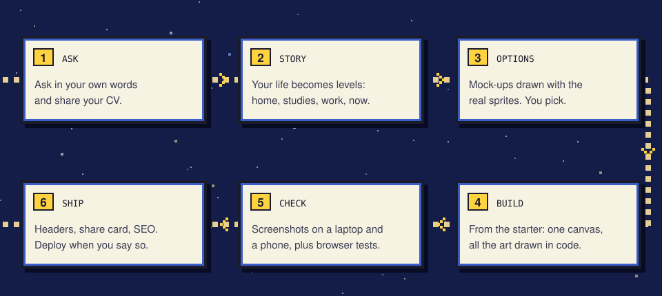
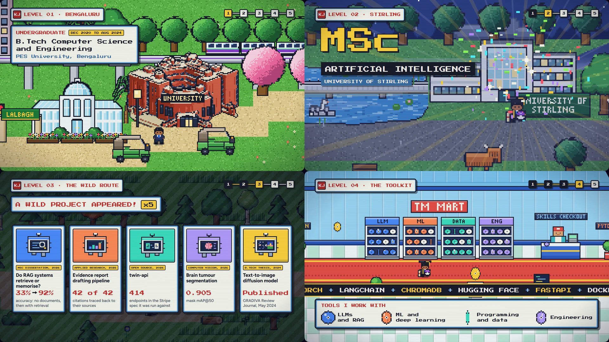

<div align="center">

# Pixel Scroll World

### Turn a CV into a world your visitors scroll through.

**Scrolling is walking. Your real CV reads in game dialogue windows. A plain layout is one click away.**

[](#set-up-your-agent) [](#set-up-your-agent) [](skills/pixel-scroll-world/assets/starter) [](#how-it-works) [](LICENSE) [](https://github.com/Shrinidhi-KJ/pixel-scroll-world/stargazers)

**[Live example](https://shrinidhi-kj.pages.dev) · [The skill](skills/pixel-scroll-world/SKILL.md) · [The starter](skills/pixel-scroll-world/assets/starter)**

[Quick start](#quick-start) · [How it works](#how-it-works) · [What you can build](#what-you-can-build) · [Showcase](#showcase) · [FAQ](#faq) · [Documentation](#documentation)

<code>npx skills add Shrinidhi-KJ/pixel-scroll-world</code>

<br /><br />


</div>

> [!TIP]
> See it working first: open [shrinidhi-kj.pages.dev](https://shrinidhi-kj.pages.dev) and scroll.
> Every technique in this skill comes from building that site.

---

Most portfolio sites look the same. This skill helps your coding agent build one that plays like a
16-bit handheld RPG: a pixel-art character walks, rides and flies through levels that tell your
story (where you grew up, where you studied, what you built, where you are now) while your CV
appears in game text boxes.

It works with **Claude Code** and **OpenAI Codex**. The agent starts from a working starter site,
asks for your story and the places that matter, shows you options before big design choices, uses
only your real content, and checks every change with screenshots on a laptop and a phone.

There's no game engine and no image files: just one canvas, vanilla JavaScript, and every sprite
drawn in code. The content stays real HTML, so it's accessible, search engines can read it, and the
same markup is the plain CV.

## Quick start

### Set up your agent

**With the skills CLI** (Claude Code, Codex and [other agents](https://github.com/vercel-labs/skills)):

```bash
npx skills add Shrinidhi-KJ/pixel-scroll-world
```

**As a Claude Code plugin:**

```text
/plugin marketplace add Shrinidhi-KJ/pixel-scroll-world
/plugin install pixel-scroll-world@pixel-scroll-world
```

**By hand:** copy the skill folder into your agent's skills directory.

```bash
git clone https://github.com/Shrinidhi-KJ/pixel-scroll-world
cp -r pixel-scroll-world/skills/pixel-scroll-world ~/.claude/skills/   # Claude Code
cp -r pixel-scroll-world/skills/pixel-scroll-world ~/.codex/skills/    # Codex
```

### Ask your agent

```text
Make my CV into a pixel-art game site. I grew up in Pune, studied at IIT Bombay,
and now work in Berlin. Here's my CV.
```

Use your own places. Photos help: the agent can redraw your real university, office or local
landmark in the world's style.

### Try the starter on its own

```bash
cp -r skills/pixel-scroll-world/assets/starter my-site && cd my-site
npm install && npm run dev
```

It runs out of the box: three levels (a home town, a university, a city at night), a walking
character, dialogue windows, glowing windows and lamps at night, a phone layout and a plain-CV
switch.

<div align="center">

</div>

## How it works

The page scrolls normally. The skill turns how far you've scrolled into a position along a route,
and the world draws itself around that position. Because everything follows from scroll position,
the scrollbar, keys, touch, links and reload all just work, and every scroll-driven scene plays
backwards when you scroll up.

<div align="center">

</div>

1. **Ask:** describe what you want in your own words and share your CV.
2. **Story:** the agent turns your life into levels: home town, studies, work, now.
3. **Options:** before a big design choice it draws mock-ups with the real sprites, so you pick.
4. **Build:** it grows your world from the starter.
5. **Check:** screenshots on a laptop and a phone, plus browser tests, after every change.
6. **Ship:** security headers, a share card, SEO, analytics if you want them. It deploys only
   when you say so.

## What you can build

Start small and add set pieces as you like. Each one has a guide the agent follows.

| Feature | What visitors see | Guide |
| --- | --- | --- |
| Levels from your CV | Home town, studies, work, now, each named in the HUD | [Story](skills/pixel-scroll-world/references/story-and-features.md) |
| Dialogue windows | Your CV in game text boxes, typed out as you arrive | [Story](skills/pixel-scroll-world/references/story-and-features.md) |
| Weather, day and night | Rain, falling petals, parallax hills, the moon setting as the sun rises | [Story](skills/pixel-scroll-world/references/story-and-features.md), [Architecture](skills/pixel-scroll-world/references/architecture.md) |
| Night lighting | Windows, lamps and signs that glow and flicker | [Architecture](skills/pixel-scroll-world/references/architecture.md) |
| Rides and a flight | An auto-rickshaw ride, a plane over a sea of clouds | [Story](skills/pixel-scroll-world/references/story-and-features.md) |
| Scroll cut-scenes | A graduation walk through the halls and over a bridge, in reverse too | [Story](skills/pixel-scroll-world/references/story-and-features.md) |
| Projects as encounters | "A wild project appeared!", with the project's facts as moves | [Story](skills/pixel-scroll-world/references/story-and-features.md) |
| A skills shop | Each skill a collectible disc on a shop shelf | [Story](skills/pixel-scroll-world/references/story-and-features.md) |
| An arcade landing | The site opens on an arcade cabinet; start zooms into its screen | [Story](skills/pixel-scroll-world/references/story-and-features.md) |
| Secrets | Pet an animal, befriend a swan, wear a traffic cone, with a badge case | [Story](skills/pixel-scroll-world/references/story-and-features.md) |
| Your real places | Buildings redrawn from photos, or rendered from a 3D model | [Pixel art](skills/pixel-scroll-world/references/pixel-art.md) |
| A plain CV | One click to a clean, accessible layout from the same markup | [Architecture](skills/pixel-scroll-world/references/architecture.md) |
| Shipping | Security headers, share card, SEO, cookie-free analytics | [Verify and ship](skills/pixel-scroll-world/references/verify-and-ship.md) |
| A showreel | A frame-exact video of your world for social posts | [Showreel](skills/pixel-scroll-world/references/showreel.md) |

## Showcase

[](https://shrinidhi-kj.pages.dev)

### shrinidhi-kj.pages.dev

The interactive CV this skill comes from. It opens in an arcade, walks through Bengaluru past a
kaapi stall and the university, flies to Scotland, graduates in the rain in Stirling, meets five
projects as wild encounters, shops for skills, and ends at night by the river in Glasgow.

[Open the site](https://shrinidhi-kj.pages.dev)

Built your own with this skill? We'd love to see it. Open an
[issue](https://github.com/Shrinidhi-KJ/pixel-scroll-world/issues/new?template=showcase.yml) with
the link and a screenshot.

## FAQ

<details>
<summary><strong>Which agents can use it?</strong></summary>

Claude Code and OpenAI Codex, and any agent that reads `SKILL.md` skills. The
[skills CLI](https://github.com/vercel-labs/skills) installs it for most of them.

</details>

<details>
<summary><strong>Do I need to know pixel art or game development?</strong></summary>

No. The agent draws everything in code from recipes in the skill (trees, buildings, characters,
water, signs) and shows you options to choose from. Your job is the story and the feedback.

</details>

<details>
<summary><strong>Does it work on phones?</strong></summary>

Yes. On a narrow screen the world becomes a strip under the nav bar and the windows scroll beneath it. The
agent checks every change on a phone-sized screen as well as a laptop.

</details>

<details>
<summary><strong>Will recruiters and search engines still be able to read my CV?</strong></summary>

Yes. The content is ordinary HTML, not pixels in the canvas. Screen readers and search engines
read it as normal, and the plain-CV switch shows the same content as a clean page.

</details>

<details>
<summary><strong>What does it cost to host?</strong></summary>

The result is a static site, so free tiers of Cloudflare Pages, Netlify or GitHub Pages work. The
guide covers deploying to Cloudflare Pages.

</details>

<details>
<summary><strong>Can I use Pokémon or other game characters?</strong></summary>

No. The skill makes original creatures and items, and keeps trademarked characters and logos out.
Generic ideas (a collectible ball, a badge case, a monster you befriend) are fine in your own
design, and so are real places and you.

</details>

<details>
<summary><strong>Will the agent make things up about me?</strong></summary>

It shouldn't. The skill tells it to use only your real content: no invented numbers, job titles
or claims. Check everything before you publish.

</details>

## Documentation

The skill is a set of Markdown files the agent reads when it needs them:

- [SKILL.md](skills/pixel-scroll-world/SKILL.md): the workflow, principles and checklist.
- [Architecture](skills/pixel-scroll-world/references/architecture.md): scroll to route to camera, depth, night lighting, the phone layout, performance.
- [Pixel art](skills/pixel-scroll-world/references/pixel-art.md): the house style, recipes, redrawing real places, mock-up options.
- [Story and features](skills/pixel-scroll-world/references/story-and-features.md): CV to levels, rides, flights, cut-scenes, battles, secrets.
- [Verify and ship](skills/pixel-scroll-world/references/verify-and-ship.md): screenshots, tests, security headers, SEO, analytics, deploying.
- [Showreel](skills/pixel-scroll-world/references/showreel.md): filming the real game frame by frame for a video.
- [`model-sprite.mjs`](skills/pixel-scroll-world/scripts/model-sprite.mjs): render a 3D model (`.glb`) into a pixel-art sprite.

```
skills/pixel-scroll-world/
├── SKILL.md
├── references/          architecture, pixel art, story, verify and ship, showreel
├── scripts/             model-sprite.mjs
└── assets/starter/      a working site to start from (Vite, vanilla JS, one canvas)
```

## Star history

<a href="https://www.star-history.com/#Shrinidhi-KJ/pixel-scroll-world&Date">
  <picture>
    <source media="(prefers-color-scheme: dark)" srcset="https://api.star-history.com/svg?repos=Shrinidhi-KJ/pixel-scroll-world&type=Date&theme=dark" />
    <source media="(prefers-color-scheme: light)" srcset="https://api.star-history.com/svg?repos=Shrinidhi-KJ/pixel-scroll-world&type=Date" />
    
  </picture>
</a>

## Contributing

Ideas, fixes and new recipes are welcome. [Open an issue](https://github.com/Shrinidhi-KJ/pixel-scroll-world/issues)
to report a bug or suggest a feature, or [send a pull request](https://github.com/Shrinidhi-KJ/pixel-scroll-world/pulls).
See [CONTRIBUTING.md](CONTRIBUTING.md) for how the repository fits together.

## License

[MIT](LICENSE). Made by [Shrinidhi KJ](https://shrinidhi-kj.pages.dev).
