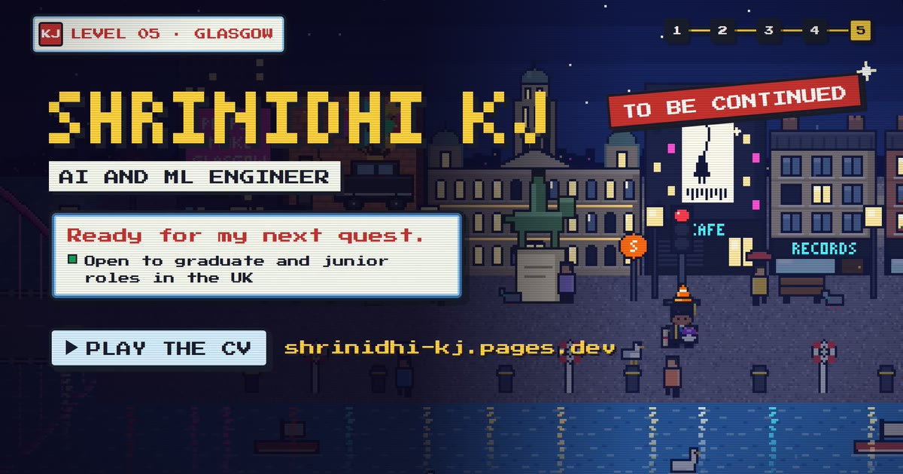
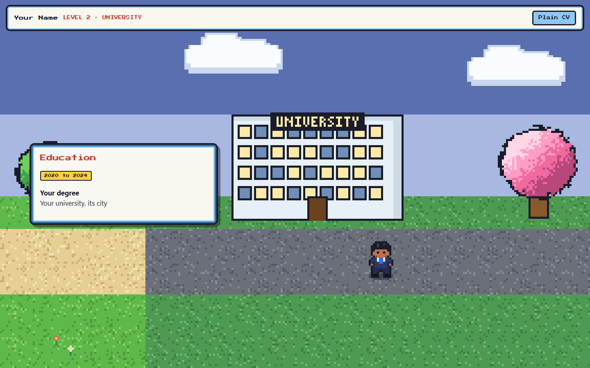

# pixel-scroll-world

An agent skill for **Claude Code** and **OpenAI Codex** that builds a website where scrolling is
walking: a pixel-art character travels through levels that tell your story, while your real CV
reads in game dialogue windows. A plain layout is always one click away.



It comes from building [shrinidhi-kj.pages.dev](https://shrinidhi-kj.pages.dev), an interactive CV
that plays like a 16-bit handheld RPG: an arcade landing screen, Bengaluru, a flight to Scotland,
a graduation walk across a footbridge in the rain, projects as wild encounters, a skills shop and
Glasgow at night.

## What's inside

```
skills/pixel-scroll-world/
├── SKILL.md                       how the agent should work: workflow, principles, checklist
├── references/
│   ├── architecture.md            scroll → route → camera, depth, night lighting, phone layout
│   ├── pixel-art.md               style rules, recipes, redrawing real places, mock-up options
│   ├── story-and-features.md      CV → levels, rides, flights, cut-scenes, battles, secrets
│   ├── verify-and-ship.md         screenshots, tests, security headers, SEO, analytics, deploy
│   └── showreel.md                filming the real game frame by frame for a video
├── scripts/model-sprite.mjs       render a 3D model (.glb) into a pixel-art sprite
└── assets/starter/                a working site to start from (Vite, vanilla JS, one canvas)
```

The starter runs out of the box: three levels (a home town, a university, a city at night), a
walking character, dialogue windows, glowing windows and lamps at night, a phone layout and a
plain-CV switch.



## Install

**Claude Code** (as a plugin):

```
/plugin marketplace add Shrinidhi-KJ/pixel-scroll-world
/plugin install pixel-scroll-world@pixel-scroll-world
```

or copy the skill folder into your personal skills directory:

```bash
git clone https://github.com/Shrinidhi-KJ/pixel-scroll-world
cp -r pixel-scroll-world/skills/pixel-scroll-world ~/.claude/skills/
```

**Codex**: copy the skill folder into your Codex skills directory (`$CODEX_HOME/skills`, usually
`~/.codex/skills`):

```bash
cp -r pixel-scroll-world/skills/pixel-scroll-world ~/.codex/skills/
```

## Use

Ask for it in your own words, for example:

> Make my CV into a pixel-art game site. I grew up in Pune, studied at IIT Bombay, and now work in
> Berlin. Here's my CV.

The agent starts from the starter, asks for your story and the places that matter, shows you
options before big design choices, uses only your real content, and checks every change with
screenshots on a laptop and a phone.

To try the starter on its own:

```bash
cp -r skills/pixel-scroll-world/assets/starter my-site && cd my-site
npm install && npm run dev
```

## Principles

- Native scroll is the only input: scrollbar, keys, touch, links and reload all just work.
- Everything is drawn in code and scaled by whole numbers, so the pixels stay crisp.
- The content is real HTML: accessible, searchable, and the same markup is the plain CV.
- No invented numbers or claims; no trademarked characters. Draw your own.

## License

MIT. See [LICENSE](LICENSE).
